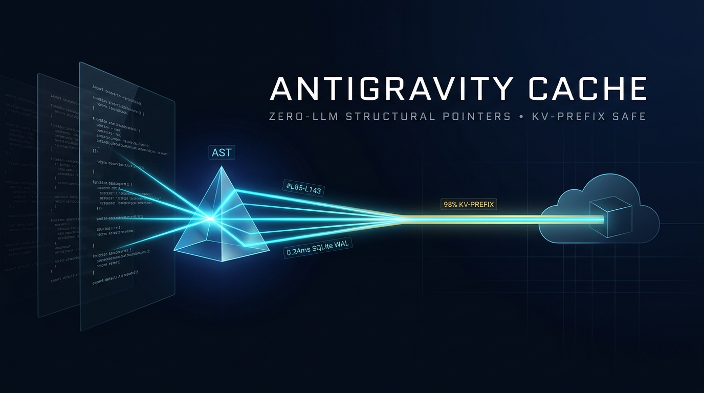
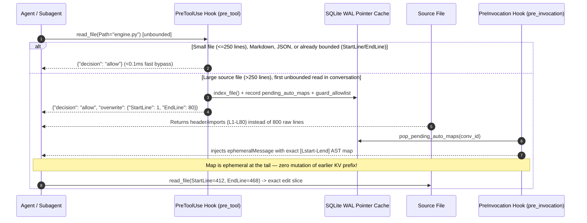

# Antigravity Cache ⚡

<div align="center">



**Zero-LLM Structural AST Pointer Cache & KV-Prefix-Safe Auto-Guard for Agentic IDEs**  
*Cut raw source-file context bloat by **75–95%** while preserving **~98% cloud KV-prefix cache hit rates** — using `0` LLM tokens and `<0.3 ms` SQLite WAL lookups.*

[](pyproject.toml)
[-F5B942.svg?style=flat-square)](scripts/kv_pointer_cache.py)
[](#-verified-telemetry--benchmarks)
[](#-verified-telemetry--benchmarks)
[](LICENSE)

[The Problem](#-solving-the-cache-on-cache-paradox) • [Auto-Guard Architecture](#-zero-willpower-auto-guard-architecture) • [Benchmarks](#-verified-telemetry--benchmarks) • [30-Second Quick Start](#-30-second-quick-start) • [Honest Edge Cases](#-honest-edge-cases)

</div>

---

## 🧠 Solving the "Cache-on-Cache" Paradox

Many agentic context optimizers accidentally make LLM coding sessions **more expensive** — a failure mode we observed firsthand when benchmarking LLM-driven rolling summary caches (such as RLM++):

| Mechanism | Rolling LLM Summary Cache (RLM++) | Naive Unbounded `read_file` | **Antigravity Cache** |
| :--- | :--- | :--- | :--- |
| **Cloud KV-Prefix Cache** | Rewrites/mutates earlier prompt history every turn, invalidating the ~90%-discounted cloud KV prefix (`0–20%` hit). | Leaves huge files permanently inside conversation history. | **100% Append-Only + `ephemeralMessage`:** Never mutates prior turns; preserves **98.4%–98.8%** cloud KV hits. |
| **Indexing Cost** | Spends extra LLM input + expensive output tokens to summarize code. | Free locally, huge LLM input cost. | **0 LLM Tokens:** Pure Python `ast` + regex + SQLite WAL (`0.24 ms` warm hit). |
| **Editing Accuracy** | Lossy ~15-word prose summaries lack exact code lines → forces a **Double-Fetch** of the raw file before editing (`summary + raw > raw`). | Reads entire 800-line blocks just to edit 20 lines. | **Exact `[Lstart-Lend]` Line Pointers & SHA-256 Hashes:** Read only the 40-line target slice (`edit_file` matches byte-for-byte). |

---

## 🛡️ Zero-Willpower Auto-Guard Architecture

Rules inside `AGENTS.md` only work when the model remembers to obey them. **Antigravity Cache** backs up guidance with deterministic lifecycle hooks (`PreToolUse` + `PreInvocation`) so an agent cannot accidentally flood your context window with 800-line raw dumps:



### Key Safeguards Built In
- **Soft `allow` + `overwrite` (Never `deny`):** Avoids frightening the agent with red security blocks or causing retry loops. It gently trims the initial read to `L1–L80` and hands over the exact AST map immediately.
- **Per-Conversation Escape Hatch (`30 min` TTL):** If an agent explicitly needs the whole file and calls unbounded `read_file` on the same path a second time within the same session, `guard_allowlist` lets it straight through.
- **Docs & Small Files Never Capped:** Only source files (`>250` lines in `.py`, `.pyi`, `.js`, `.jsx`, `.ts`, `.tsx`, `.rs`, `.go`) trigger Auto-Guard. Markdown (`SKILL.md`, `README.md`), configs (`.json`), and bounded reads pass through untouched.
- **Small-File Auto-Inline (`map` CLI):** Running `kv_pointer_cache.py map <file>` on a file with `<=250` lines automatically prints numbered source lines (`1: ...`) instead of an abstract outline — eliminating `map` → `read_file` double-fetches on small files (`--force-map` overrides).

---

## 📊 Verified Telemetry & Benchmarks

Measured on real production repositories (`0` LLM tokens consumed; run on Windows Python 3.13 + SQLite WAL):

| Metric | Measured Result | Notes |
| :--- | :--- | :--- |
| **Warm Pointer Skip / Map Median** | **`0.241 ms`** | `(mtime_ns, size_bytes)` stat check avoids re-parsing unchanged files |
| **Structural Map vs. Full File** | **`91.31%` saved** | `26` real files benchmarked (`10.3 KB` compressed AST + call edges vs full source) |
| **Symbol Slice vs. Full File** | **`93.5%` saved** | Reads exact contiguous target lines matching `edit_file` byte-for-byte |
| **Cloud KV-Prefix Hit Rate (3d aggregate)** | **`89.25%` overall** | `281.6M` cached / `315.5M` total context tokens across conversations |
| **Consecutive Same-Model Turns** | **`98.4% – 98.8%` cached** | Preserved by strictly append-only context + `ephemeralMessage` tail delivery |

Supported languages out of the box: **Python** (exact `ast`, decorators, `@overload`, `@property.setter`, intra-file call graph), **JavaScript / TypeScript** (`class`, functions, arrow exports), **Rust** (`#[attr]`, `struct`, `enum`, `impl` methods), **Go**, and **Markdown** (fence-aware heading tree).

---

## 🚀 30-Second Quick Start

Zero external dependencies — requires only **Python 3.10+** (stdlib `sqlite3`, `ast`).

### Option 1: Install as an Antigravity 2.0 Plugin (Recommended for Teams)

```bash
git clone https://github.com/Aphygo/Antigravity-cache.git
cd Antigravity-cache
python install.py --check   # verify environment & check for duplicate global hooks
python install.py           # installs to ~/.gemini/config/plugins/antigravity-cache
```

Works identically on **Windows, macOS, and Linux** — `install.py` automatically binds `hooks.json` to the exact `sys.executable` path on your machine. To preview without writing (`--dry-run`) or remove cleanly (`--uninstall`):

```bash
python install.py --dry-run
python install.py --uninstall
```

### Option 2: Standalone CLI Usage

```bash
# 1. Inspect a large file's AST map + call edges (or auto-inline if <=250 lines)
python scripts/kv_pointer_cache.py map path/to/large_module.py

# 2. Search symbols across a repository by name, docstring, signature, or callees
python scripts/kv_pointer_cache.py locate settle_step --root ./src

# 3. Extract exact lines for one class, method, or function
python scripts/kv_pointer_cache.py slice path/to/large_module.py AttractorRunner.step

# 4. Run cumulative token-savings benchmark + inspect Antigravity cloud KV-cache hits
python scripts/kv_pointer_cache.py stats
```

Run the self-contained test suite anytime with:

```bash
pytest -v
```

---

## ⚖️ Honest Edge Cases

No caching tool eliminates every token everywhere:

1. **Cross-Model Phase Handoffs (e.g., Orchestrator Planner ↔ Executor):** Each cloud model maintains its own KV-cache layout. During the single step where control hands off from an executor back to a planner (or vice versa), that model warms its KV cache for newly added turns (`~1` uncached step) before returning to **98–99%** cache hits on subsequent turns. Keeping full files out of history shrinks that handoff cost dramatically.
2. **Very Tiny Files Without Auto-Inline:** Mapping a 30-line config manually adds CLI wrapper framing tokens if you ignore line numbers — which is why Auto-Guard stays off below `250` lines and the `map` CLI automatically inlines small files directly.

---

Built with ❤️ at **Aphygo** to keep agentic engineering fast, inspectable, and zero-waste.
